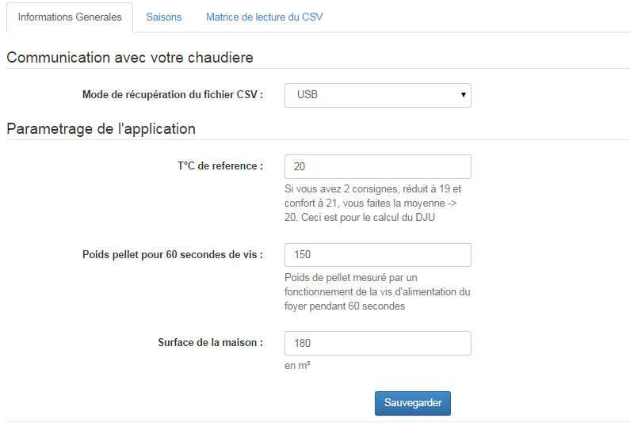

# Informations générales

!!! warning

    Vous devez être **authentifié**. Cette page est accessible depuis le menu **Informations générales**.

!!! important

    Choisissez le mode de récupération des données de la chaudière : **USB** ou **IP**.

Renseignez les paramètres suivants :

- **Température de référence dans votre logement** : si la température réduite est de 19,5 °C et la température de confort de 20 °C, saisissez leur moyenne. Cette valeur sert à calculer les DJU (degrés-jours unifiés), qui permettent de comparer les besoins énergétiques. Vous pouvez aussi choisir une base de 20 °C (DJU 20) ou de 18 °C (DJU 18).
- **Poids des granulés** : mesurez la quantité de granulés distribuée par la vis sans fin en 60 secondes.
- **Surface du logement** : cette valeur sert à calculer l’indicateur g/DJU/m², qui permet de comparer les performances de votre installation.

