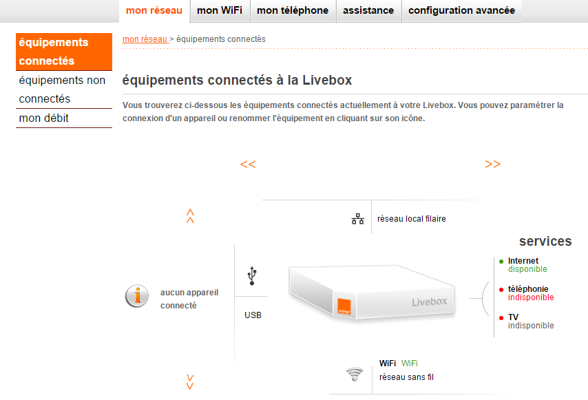
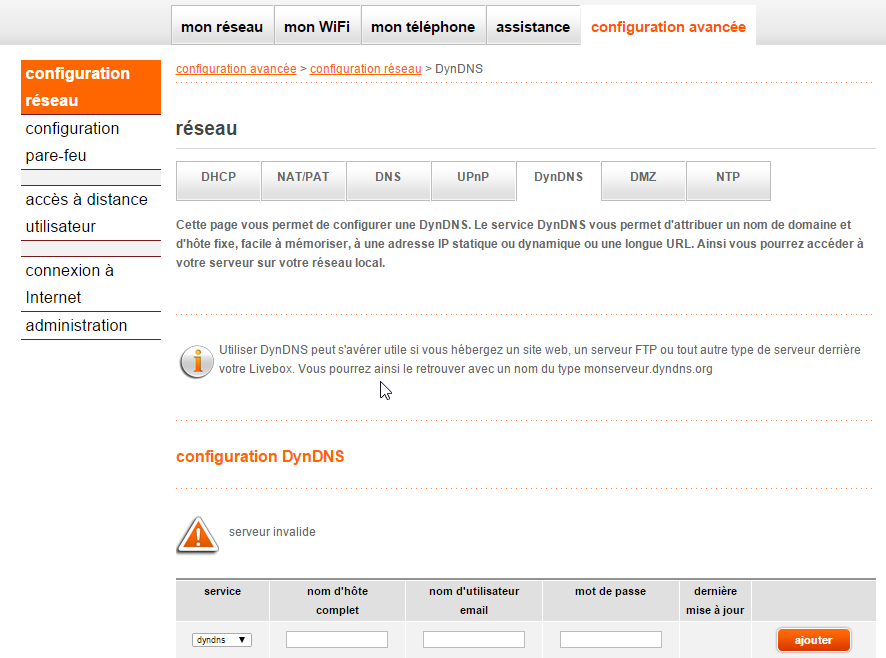
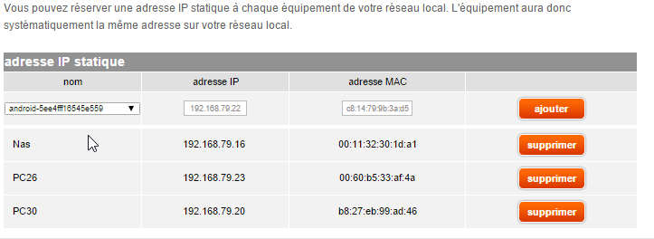
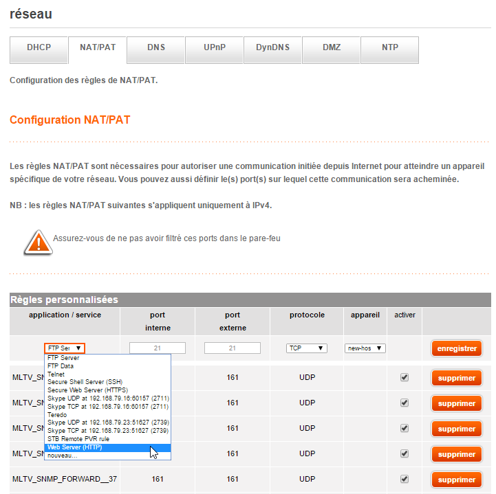
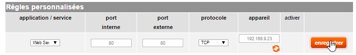
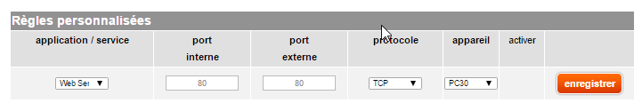
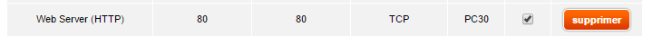
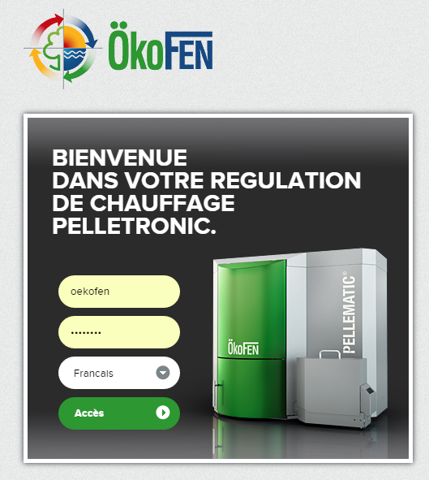

# Configurer une Livebox Orange

!!! important

    Cette procédure concerne les chaudières ÖkoFEN équipées du firmware V2 ou V3.

    Suivez ces étapes uniquement si vous hébergez Okovision en dehors de votre réseau domestique.

## Créer un nom de domaine dynamique avec No-IP

Si vous n’avez pas de Livebox Pro, votre Livebox change régulièrement d’adresse IP. Pour éviter d’avoir à suivre ces changements, Orange propose une fonctionnalité permettant d’utiliser un service DNS dynamique.

Commencez par créer un compte sur le site [No-IP](https://www.noip.com/sign-up). Par exemple, si votre nom est `DUPOND`, vous pouvez choisir un nom de domaine dynamique tel que `dupond.ddns.net`.

Dans la suite de ce guide, nous utiliserons `dupond.ddns.net` comme exemple. Choisissez l’offre gratuite (« Free Sign-up »).

Une fois votre compte créé et validé, configurez la Livebox.

## Configurer la Livebox pour utiliser No-IP

Connectez-vous à votre Livebox à l’adresse <http://livebox.home/>.

Ouvrez le menu `Configuration avancée`.



Puis sélectionnez « DynDNS ».



- Saisissez le nom de domaine choisi (ici, `dupond.ddns.net`).
- Sélectionnez le service `no-ip`.
- Saisissez l’adresse e-mail et le mot de passe associés à votre compte `noip.com`.

## Repérer l’adresse IP de votre chaudière

Consultez la documentation ÖkoFEN. Nous vous conseillons de configurer une adresse IP statique sur la chaudière plutôt que d’utiliser le DHCP. En cas de coupure de courant, la chaudière peut redémarrer avant la Livebox. Celle-ci ne serait alors pas disponible pour lui attribuer une adresse IP. Il est donc préférable de définir une adresse IP fixe.

Notez l’adresse IP de votre chaudière, par exemple `192.168.xxx.xxx`.

Dans cet exemple, la chaudière est nommée `PC30` ; son adresse IP a été relevée directement sur l’appareil.



## Rendre votre chaudière accessible depuis Internet (redirection de port)

Votre nom de domaine `dupond.ddns.net` pointe vers votre Livebox. Pour accéder à votre chaudière à cette adresse, configurez la Livebox afin qu’elle redirige vers le port 80 de la chaudière le trafic entrant sur son port 80.

!!! warning

    Vous pouvez rediriger un autre port (supérieur à 1024) de la Livebox vers le port 80 de la chaudière. **Selon votre hébergeur, vous devrez peut-être utiliser une redirection de 80 vers 80 ou de 8080 vers 80.**

Ouvrez la section **NAT/PAT**.



Sélectionnez le service `web server http`, puis renseignez les paramètres suivants :

```txt
port interne: 80
port externe: 80 ou 8080
protocole: TCP
appareil: soit il est dans la liste, soit vous saisissez son adresse IP
```

Enregistrez la règle.




La règle doit alors apparaître dans la liste des services.



## Vérifier le fonctionnement

Vous ne pourrez pas vérifier la configuration depuis votre réseau domestique. En revanche, vous pouvez effectuer le test avec un téléphone connecté au réseau mobile (3G ou 4G).

Ouvrez le nom de domaine dynamique choisi (dans notre exemple, `dupond.ddns.net`). La page de connexion de la chaudière devrait s’afficher.



!!! note

    Si tout fonctionne, indiquez `dupond.ddns.net` comme adresse IP dans la section `Informations générales` d’`Okovision`. Il s’agit d’un exemple ; utilisez le nom de domaine que vous avez choisi.
