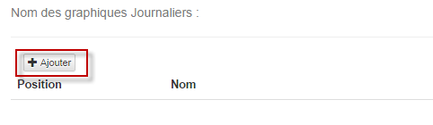
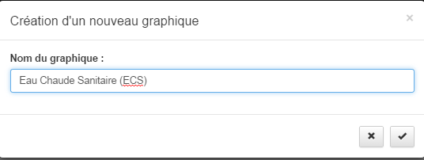
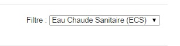
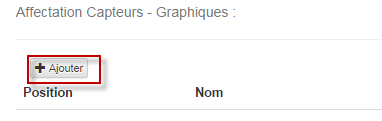
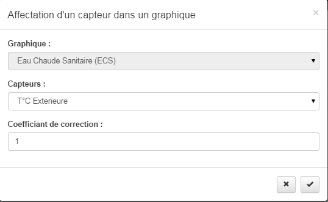
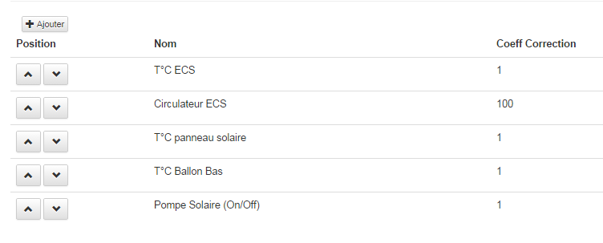
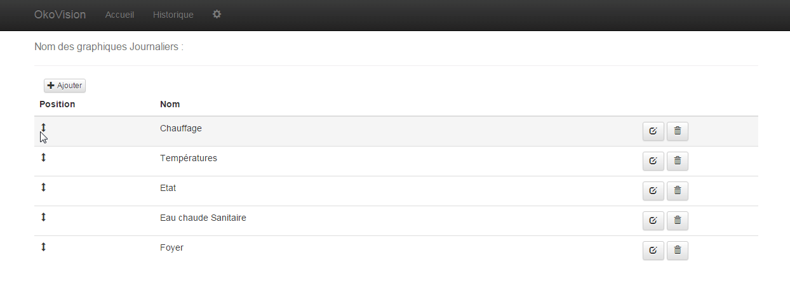
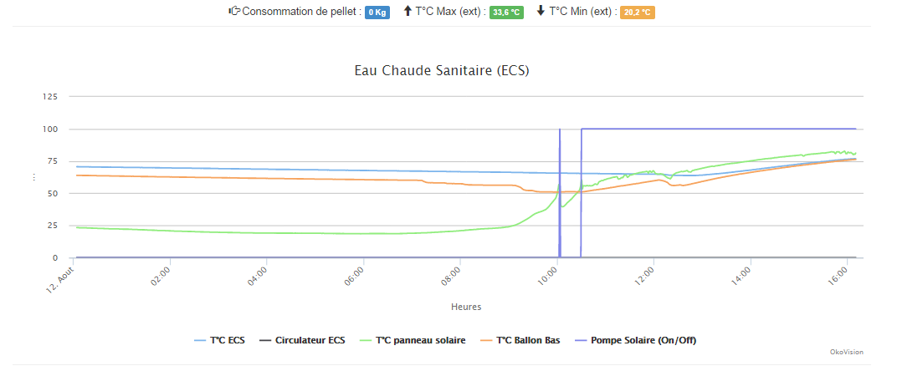

# Création et gestion des graphiques journaliers

!!! warning

    Vous devez être **authentifié**. Cette page est accessible depuis le menu **Gestion des rapports journaliers**.

## Créer un graphique

**Choisissez le nom du graphique.**

!!! note

    Vous pouvez créer autant de graphiques que vous le souhaitez. Ils seront tous visibles sur la page d’accueil d’Okovision.

## Ajouter des capteurs au graphique

Sélectionnez le graphique dans la liste `FILTRE`.

Cliquez sur `Ajouter`. Dans la fenêtre qui s’ouvre, choisissez un capteur et appliquez-lui, si nécessaire, un coefficient correcteur afin d’harmoniser l’échelle des données.

Répétez l’opération jusqu’à obtenir le graphique souhaité.

### Modifier l’ordre des graphiques

## Consulter les données

Après avoir importé les données dans Okovision, vous pouvez les consulter sur la page d’accueil.

