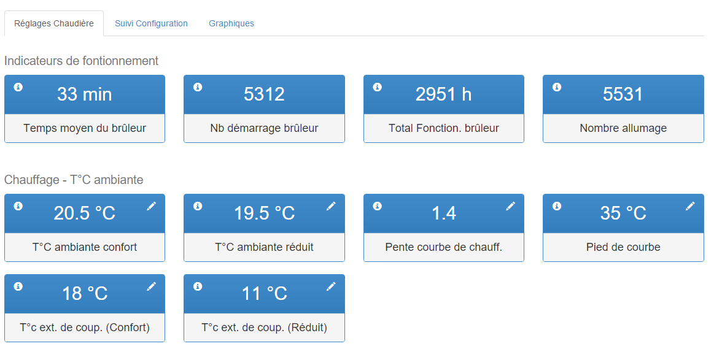
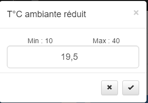
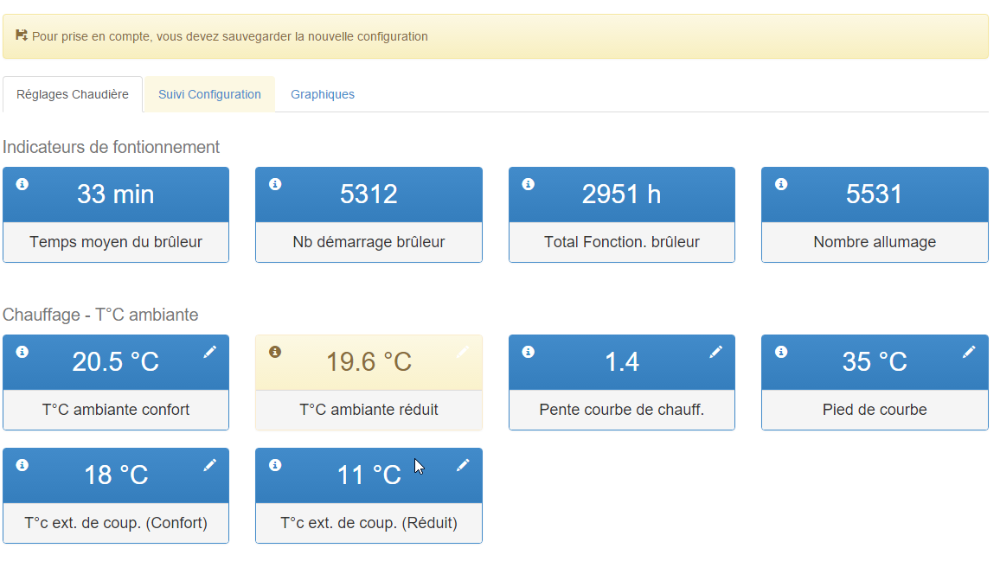
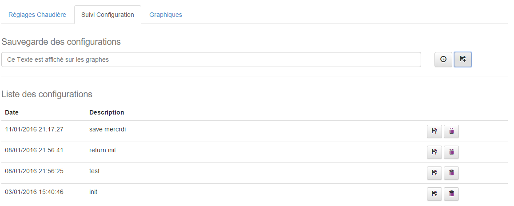
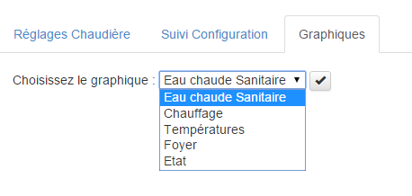
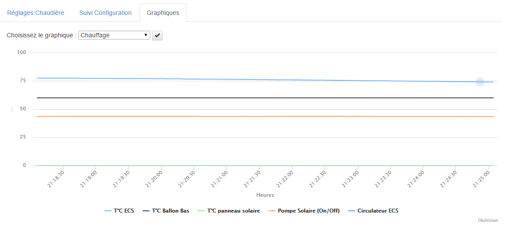

# Temps Réel

!!! note

    Cette section vous permet de consulter les informations de votre chaudière en temps réel.

    Vous pouvez également les modifier et enregistrer vos changements.

## Consulter et modifier les paramètres de votre chaudière

Commencez par saisir les identifiants que vous utilisez pour vous connecter à l’interface web de votre chaudière.

Cliquez sur l’icône suivante :

, puis ouvrez le menu `Temps réel`.

Okovision pourra alors se connecter à votre chaudière et récupérer les informations nécessaires.

Vous pouvez modifier chaque paramètre.

Les paramètres modifiés ne seront appliqués à la chaudière qu’après leur enregistrement.

Saisissez une description. Ce texte apparaîtra sur les graphiques journaliers.

Vous pouvez également consulter en temps réel les courbes des graphiques que vous avez créés.

