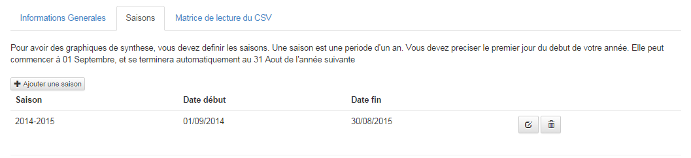

# Créer les saisons

!!! warning

    Vous devez être **authentifié**. Cette page est accessible depuis le menu **Saisons**.

    La création des saisons est nécessaire pour générer les graphiques de synthèse.

Saisissez la date de début de votre saison. Dans l’exemple ci-dessous, elle commence le 1er septembre, mais vous pouvez choisir la date qui vous convient.

