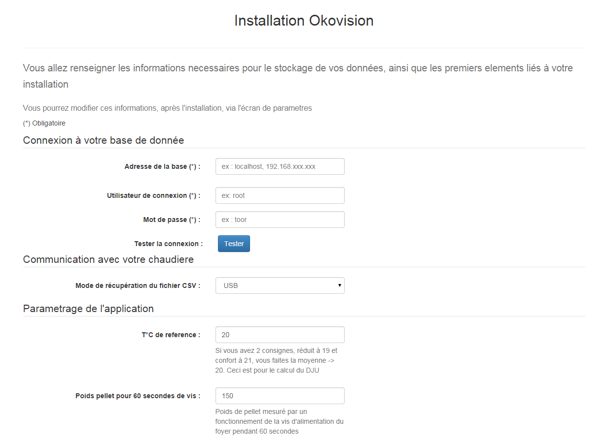
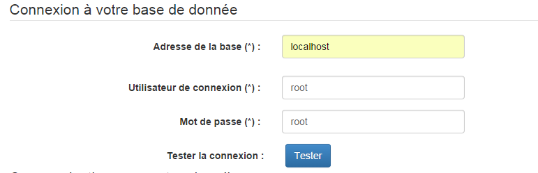
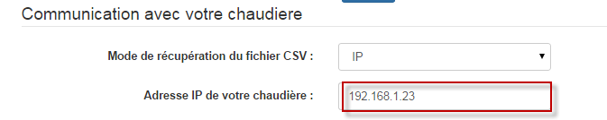
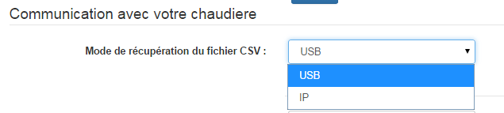
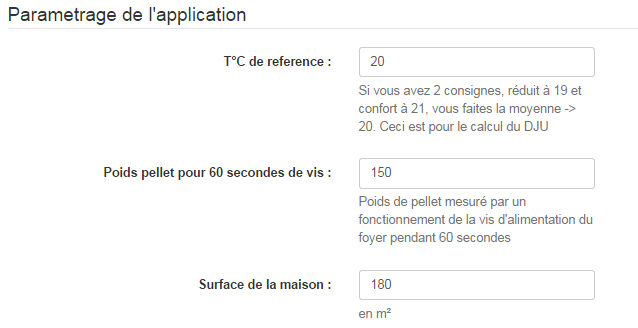
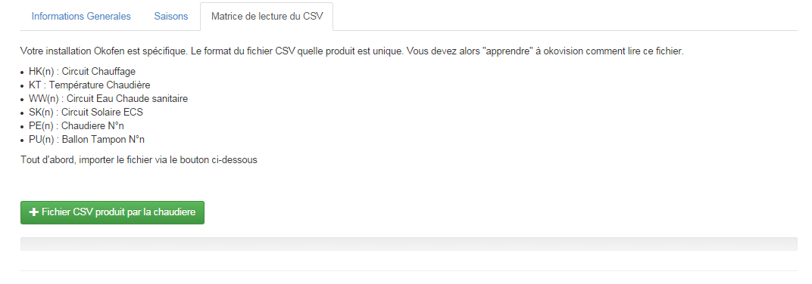
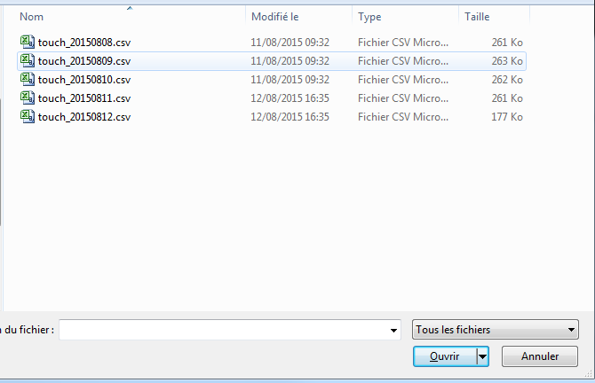
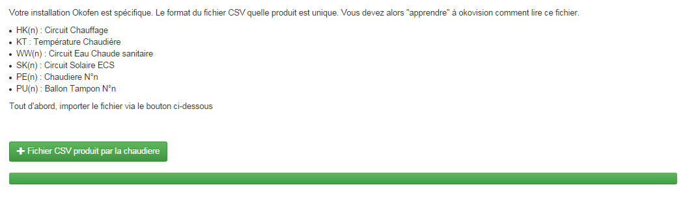
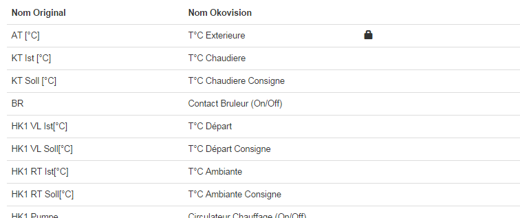

# Configuration initiale

## Configuration et connexion à la base de données

- Si vous utilisez Windows et avez suivi le tutoriel, indiquez `localhost` comme hôte et `root` comme nom d’utilisateur et mot de passe (comme dans l’exemple ci-dessous).
- Si vous utilisez un Raspberry Pi ou Linux, indiquez `localhost`, puis saisissez le nom d’utilisateur et le mot de passe de votre base de données.
- Si vous utilisez un NAS Synology, indiquez `localhost` et `root` comme nom d’utilisateur. Par défaut, aucun mot de passe n’est défini.

**Si la connexion fonctionne**, le bandeau suivant s’affichera :

## Mode de récupération des fichiers CSV

Si votre chaudière est connectée à votre réseau local, indiquez son adresse IP. Vous pourrez la modifier ultérieurement dans le menu de configuration.

!!! note

    Si vous utilisez un hébergement externe, consultez le chapitre [Configurer votre box pour accéder à la chaudière depuis Internet](/documentation/configuration/livebox.md).

    Sinon, choisissez **USB** pour transférer manuellement les fichiers récupérés.

## **Paramétrage spécifique** de votre installation

## Matrice de lecture

!!! note

    Cette étape est indispensable.

### Détecter les capteurs de votre chaudière

Chaque installation est différente : présence ou non d’un système d’eau chaude sanitaire (ECS), d’un plancher chauffant, d’un ballon tampon ou de panneaux solaires, par exemple.

!!! note

    **Okovision** peut gérer ces différentes configurations, mais vous devez d’abord lui indiquer comment votre installation est composée.

    Pour cela, fournissez-lui un fichier CSV généré par la chaudière.

    Okovision analysera ce fichier pour terminer l’installation.

Okovision dispose d’un dictionnaire qui traduit en français les noms des capteurs et des circuits.

!!! important

    [Après vous être identifié](/documentation/configuration/login.md), rendez-vous sur la page *Matrice de lecture CSV*.

Sélectionnez le fichier CSV produit par votre chaudière et enregistré sur votre ordinateur.

Importez le fichier dans Okovision.

## Apprentissage terminé

Une fois l’analyse terminée, Okovision affiche la structure détectée.

Vous retrouverez la liste des capteurs dans la page [Création et gestion des graphiques journaliers](/documentation/configuration/manage-graphics.md).

