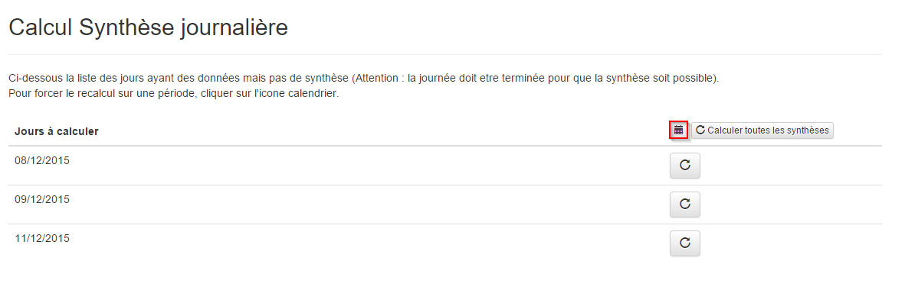
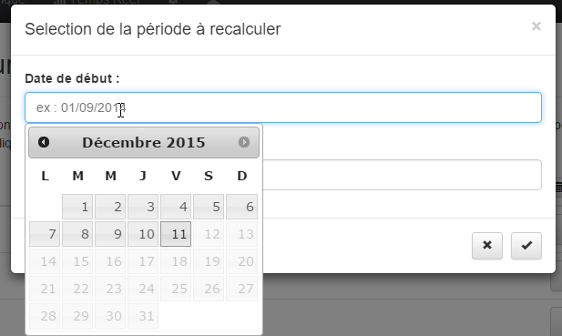

# Synthèse journalière

!!! warning

        Vous devez être **authentifié**. Cette page est accessible depuis le menu **Calcul des synthèses journalières**.

## Calculer les synthèses après des imports manuels

Cliquez sur chaque journée à traiter, ou sur `Calculer toutes les synthèses`.

## Recalculer plusieurs synthèses journalières

Si vous modifiez des paramètres dans la configuration générale (température ou poids des granulés, par exemple), ces nouvelles valeurs seront prises en compte dans les prochaines synthèses.

!!! note

    Pour appliquer ces changements aux journées précédentes, vous devez recalculer les synthèses correspondantes.

Pour cela, cliquez sur le calendrier et indiquez la période à recalculer.

