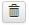

# Gestion de la matrice

!!! warning

    Vous devez être **authentifié**. Cette page est accessible depuis le menu **Matrice de lecture CSV**.

!!! note

    La suppression de la matrice n’efface pas les données existantes. En revanche, vous ne pourrez plus en ajouter **tant que vous n’aurez pas recréé une matrice**.

La structure du fichier CSV généré par votre chaudière peut changer si vous modifiez votre installation, par exemple en cas de :

- ajout d’un circuit de chauffage ;
- ajout d’un capteur solaire ;
- mise à jour du firmware.

Dans ces situations, vous devez mettre à jour la matrice.

!!! important

    L’importation des données ne fonctionnera plus tant que vous n’aurez pas mis à jour la matrice.

 Cliquez sur l’icône de mise à jour.

Importez à nouveau un fichier CSV provenant de votre chaudière.

## Suppression de la matrice

Si un problème lors de l’importation d’un fichier CSV a rendu la matrice incohérente :

 Cliquez sur cette icône pour supprimer la matrice.

!!! Attention

    **Toutes les données journalières seront supprimées.** L’historique, en revanche, sera conservé.
