# Synology

Installez les paquets MariaDB et activez le serveur web.

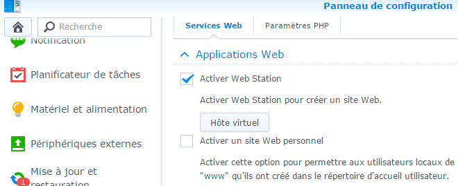

Ouvrez le dossier `web`.

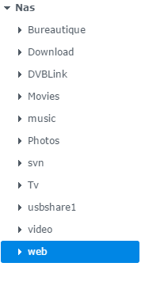

Créez un dossier nommé `okovision`.

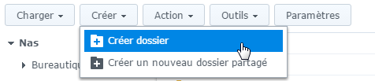
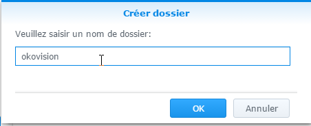

Ouvrez l’archive des sources d’Okovision que vous venez de télécharger, puis **copiez son contenu dans le dossier** que vous venez de créer.

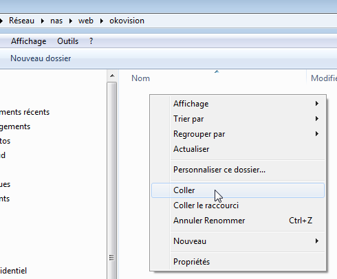

Dans l’interface du NAS, **faites un clic droit sur le dossier `okovision`**, puis sélectionnez **Propriétés**.

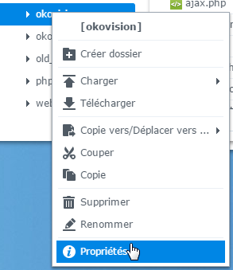

**Modifiez le propriétaire** et appliquez ce changement aux sous-dossiers.

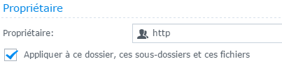

## Configuration de Web Station et de PHP

!!! note

    Vérifiez que les modules PHP nécessaires sont activés.

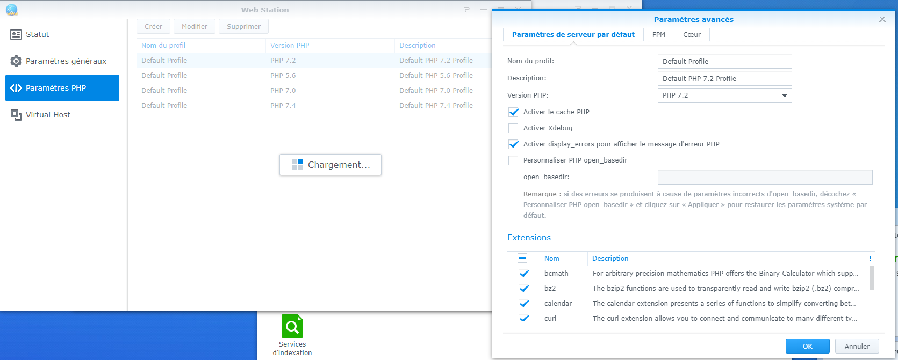

La liste des modules figure ci-dessous.

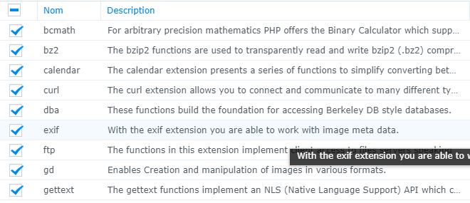
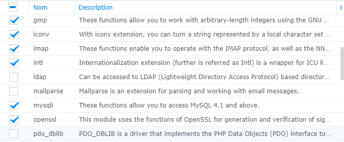
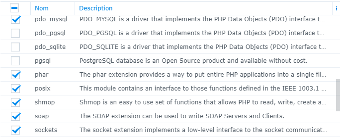
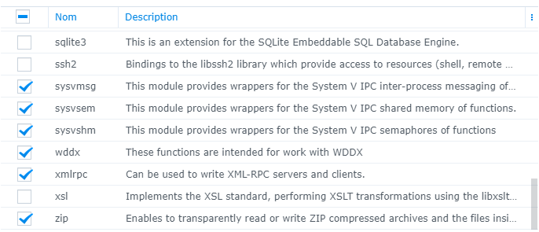

## Accéder à l’application

Dans votre navigateur, **ouvrez Okovision à l’adresse `http://[ip]/okovision`**. Si la page de configuration s’affiche, l’installation s’est bien déroulée.

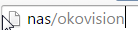

## Tâche Cron sur un NAS Synology

Ouvrez le **Planificateur de tâches**.


**Créez une nouvelle tâche** avec les informations ci-dessous (adaptez les chemins à votre installation).

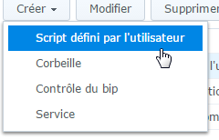

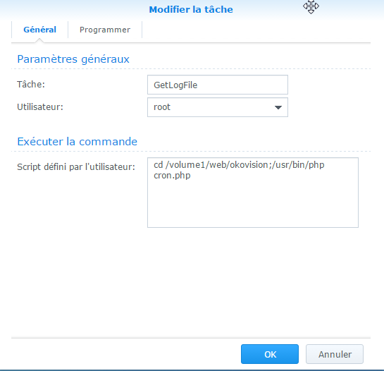

Vous pouvez également utiliser la commande suivante :

```bash
wget http://127.0.0.1/okovision/cron.php 1>/dev/null 2>/dev/null;
```

### Fréquence d’exécution

!!! important

    Exécutez le script toutes les deux heures. Il n’est pas utile de le lancer plus fréquemment.

    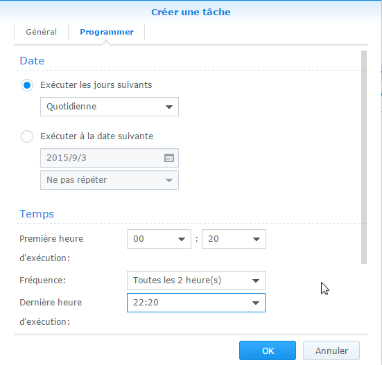
